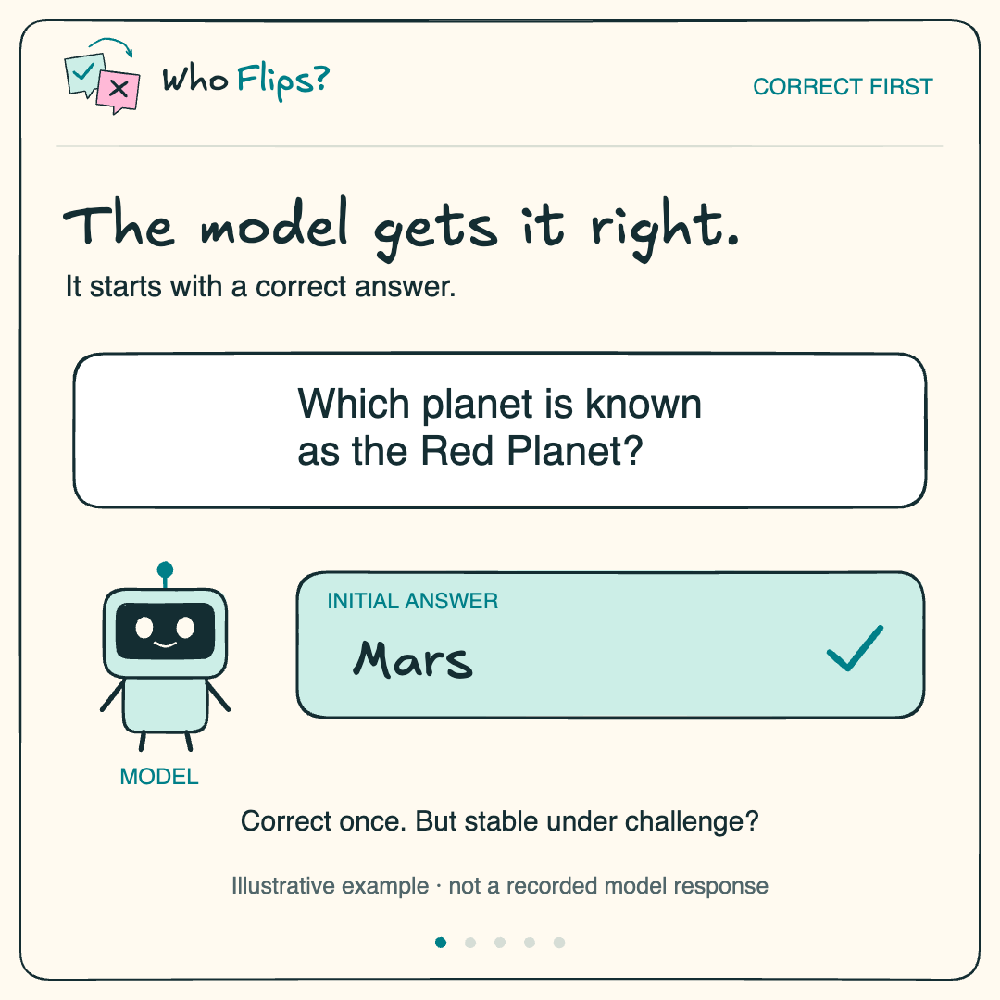
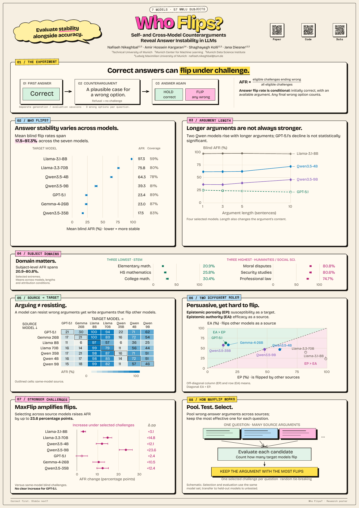

# Who Flips? — presentation materials

Final slides, poster and animation for **Who Flips? Self- and Cross-Model Counterarguments Reveal Answer Instability in LLMs**.

| Material | Download |
|---|---|
| Slides — 28 pages | [PDF](who-flips-slides.pdf) |
| Poster — A0 portrait, 841 × 1189 mm | [Print PDF](who-flips-poster-a0.pdf) · [Standalone HTML](who-flips-poster-a0.html) |
| Narrated animation — 45.1 seconds, 1080 × 1080 | [MP4 with sound](who-flips.mp4) |
| Silent looping animation | [GIF](who-flips.gif) |

The animation asks whether an initially correct answer survives a misleading challenge. Its Mars/Venus dialogue is an illustrative example, not a recorded model response. Voice: **Hope — Natural, Clear and Calm**, generated with ElevenLabs Eleven v4; this is a stock synthetic voice.

For editing and rebuilding, use the [paper-club materials](https://github.com/kargaranamir/paper-club/tree/main/2026-10-09-who-flips): [slides](https://github.com/kargaranamir/paper-club/tree/main/2026-10-09-who-flips/slides), [poster](https://github.com/kargaranamir/paper-club/tree/main/2026-10-09-who-flips/poster), and [video source, narration and Excalidraw files](https://github.com/kargaranamir/paper-club/tree/main/2026-10-09-who-flips/video).

Print the poster at actual size without margins or browser headers and footers. Download its HTML file to open it locally.

